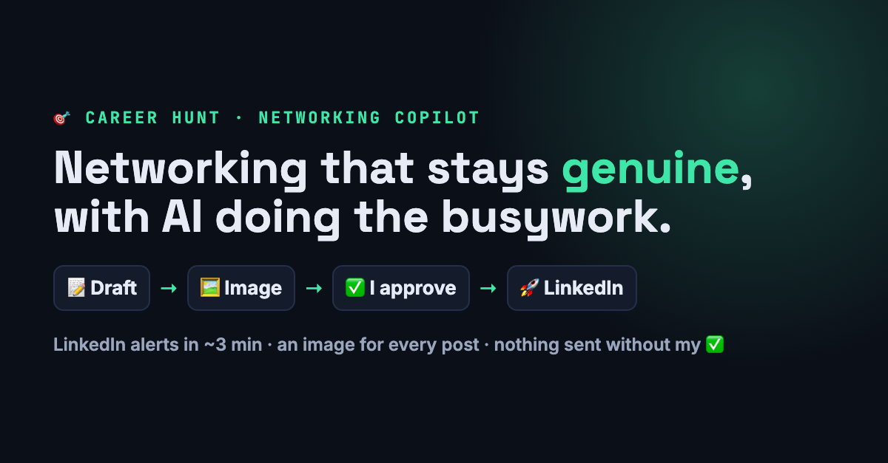
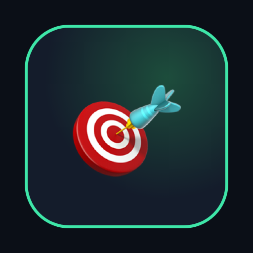
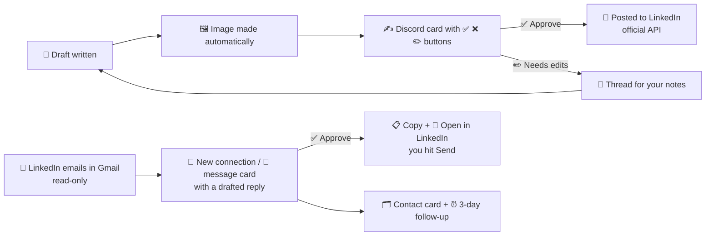
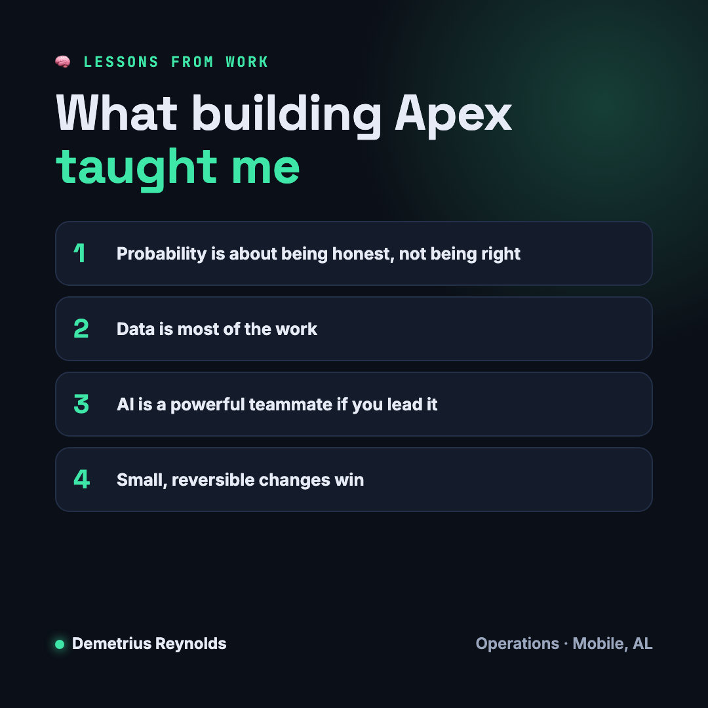
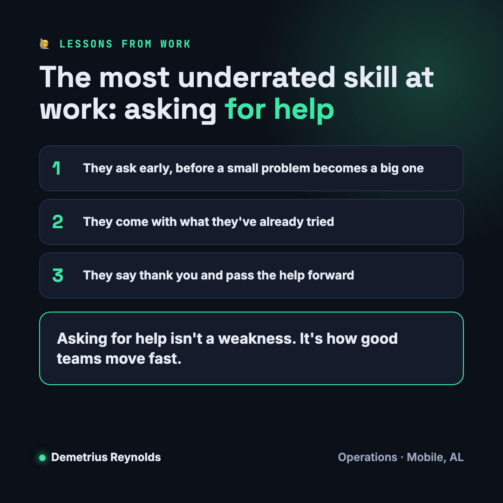

<p align="center"><a href="https://demetriusreynolds251-maker.github.io/career-hunt/"></a></p>
<p align="center"><a href="https://demetriusreynolds251-maker.github.io/career-hunt/"><b>▶ See how it works</b></a></p>

<p align="center"></p>

# 🎯 Career Hunt

**A Discord command center for job hunting and genuine networking.** It drafts LinkedIn posts (each with its own image), turns new LinkedIn connections and messages into suggested replies, keeps a simple contact list, and reminds you to follow up. Every message and post waits for your **✅ Approve** first.

> **Note:** Designed and directed by Demetrius Reynolds and built with AI coding assistants. I understand the code and architecture but am not a professional software engineer.

## Why I built it

Networking works when it's personal and consistent, and that's the hard part. I wanted one place that tells me who to follow up with today, drafts the first version of a post or reply, and keeps me honest with a weekly scorecard. I still make every decision and send every message myself.

## How it works



| Part | File | What it does |
|---|---|---|
| Bot | `careerhunt_bot.py` | Discord bot: draft cards with Approve / Reject / Needs-edits buttons, replies in every channel, follow-up reminders, daily check-in streaks, timelines on everything |
| Post images | `make_image.py` | Turns any draft into a 1080×1080 image (title, key points, callout), so every post has a visual |
| LinkedIn posting | `linkedin.py` | Posts approved drafts with LinkedIn's official "Share on LinkedIn" API (OAuth, about 60-day token, expiry reminder) |
| Inbox alerts | `inbox.py` | Reads **only** LinkedIn notification emails (read-only IMAP) for new connections, invites and messages, then drafts a reply |
| Server setup | `build_server.py`, `fill_channels.py` | Builds the Discord categories and emoji channels and posts starter templates |

## Built with care

- **Nothing sends itself.** Posts publish only on ✅ Approve. Replies are copied and sent by hand.
- **No scraping, no logging in as you.** LinkedIn data comes from LinkedIn's own emails and its official posting API, so your account stays safe.
- **Honest messages.** Templates avoid claims you haven't confirmed, and you edit before anything goes out.
- **Secrets stay local.** Tokens and passwords live in `secrets/` (ignored by git). See `secrets.example/`.

## Example post images

<p> </p>

## Run it (placeholders)

```bash
pip install discord.py playwright
python3 -m playwright install chromium
mkdir secrets && cp secrets.example/* secrets/   # then fill in your own values
python3 build_server.py && python3 fill_channels.py   # one-time Discord setup
python3 careerhunt_bot.py                            # or use deploy/com.careerhunt.bot.plist (macOS)
```

Needs a Discord bot with **Message Content Intent** on. LinkedIn posting needs a LinkedIn developer app with *Share on LinkedIn* and *Sign In with LinkedIn using OpenID Connect* (`python3 linkedin.py --auth-url`). Inbox alerts need a Gmail app password.

## More from me

🌐 [About me](https://demetriusreynolds251-maker.github.io) · 🧪 [Apex: sports analytics system](https://demetriusreynolds251-maker.github.io/apex/) · 🤝 [LinkedIn](https://www.linkedin.com/in/demetrius-reynolds/)

## License

[Share-Back License 1.1](LICENSE): free to use and learn from for non-commercial purposes. Share what you build or learn back publicly, credit "Based on Career Hunt by Demetrius Reynolds", and ask before any commercial use.
